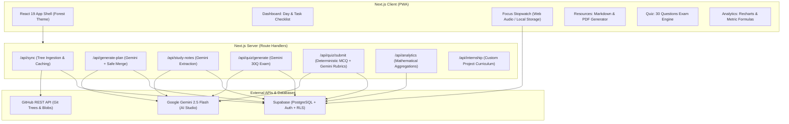

# StudyForge — System Architecture & Technical Specifications

StudyForge is an autonomous AI-driven curriculum ingestion engine and study companion that dynamically analyzes code and markdown roadmaps from GitHub repositories, structures them into actionable daily learning plans, provides interview-depth study notes, generates exam-style active recall quizzes, and tracks focus time.

---

## 1. High-Level Architecture Diagram



---

## 2. Component Design & Responsibilities

1. **GitHub Ingestion Engine (`/lib/github.ts`)**:
   - Fetches repository tree recursively via `https://api.github.com/repos/{owner}/{repo}/git/trees/{branch}?recursive=1`.
   - Discovers days using regex matching `/day(\d+)/` for directory layouts and `day(\d+).md` for flat files.
   - Respects user-configured `rootPath` and filters out excluded folders (`archive`, `archived`, `.git`).
   - Caches files deterministically by `git_sha` and generates a composite `content_hash` for each day.
   - Wraps all repo files in untrusted boundary blocks to prevent prompt injections.

2. **AI Study Plan Generator (`/app/api/generate-plan/route.ts` & `/lib/gemini.ts`)**:
   - Feeds Day files into Gemini with structured Zod schemas.
   - Strictly segments tasks into 3 core tracks: Language, DSA, and Project.
   - Employs exponential backoff, timeouts, and automatic retry on JSON schema violations.
   - Instrumentations: Logs latency in milliseconds and candidate/prompt token counts.

3. **Safe Task Merge Engine (`/lib/tasks.ts`)**:
   - **Critical Invariant**: Any task with `user_edited: true` is **NEVER** overwritten during re-syncs.
   - Matches incoming plan tasks with existing records by `source_hash` or title.
   - Preserves manual notes, custom planned minutes, start times, and completion timestamps.

4. **Focus Stopwatch & Ambient Synthesizer (`/lib/audio.ts` & `/app/focus/page.tsx`)**:
   - Computes elapsed time purely from system timestamps stored in `localStorage` (`sessionStart`, `lastResumed`, `accumulatedSeconds`).
   - Completely immune to browser tab throttling, sleep modes, or page reloads.
   - Generates synthetic White, Brown (rain), and Pink (leaves) noise mathematically via the Web Audio API without requiring external audio assets.
   - Renders a reactive procedural SVG tree that advances through growth stages (Sprout → Seedling → Sapling → Mature Oak → Ancient Forge Pine).

5. **Active Recall Quiz Engine (`/lib/quiz.ts` & `/app/quiz/page.tsx`)**:
   - Generates 30 questions dynamically on the spot from the day's repo content:
     * 15 Multiple Choice Questions (MCQ)
     * 8 Practical Coding Questions
     * 7 Subjective/Conceptual Questions
   - Evaluates MCQs **deterministically** on the server without consuming LLM tokens.
   - Evaluates coding and subjective questions via Gemini against rigorous question rubrics.
   - Caches quizzes by `(day_id, content_hash)` and logs all attempts in `quiz_attempts`.

6. **Analytics Engine (`/lib/analytics.ts` & `/app/analytics/page.tsx`)**:
   - Computes metrics using explicit, transparent mathematical formulas shown directly in the UI.
   - Recharts visualizes daily focus minutes, per-track distribution, and quiz score progress.
   - Zero invented "scores" or gamified black-box metrics.

---

## 3. Database Schema & RLS Policies

All tables reside in the `public` schema and enforce PostgreSQL Row Level Security (RLS) ensuring `user_id = auth.uid()`:

- `days`: Stores discovered curriculum days, repository paths, and content hashes.
- `source_files`: Caches markdown and code blobs associated with days by git sha.
- `tasks`: Hierarchical tasks and subtasks (`parent_id`), track enum (`language`, `dsa`, `project`, `internship`), completion timestamps (`done_at`), and `user_edited` flags.
- `focus_sessions`: Logs focused seconds, start/end timestamps, and linked task IDs.
- `study_notes`: Caches interview-depth markdown notes per day and topic.
- `quizzes`: Stores generated 30-question exam definitions and rubrics.
- `quiz_attempts`: Records student answers, deterministic scores, AI rubric feedback, and overall marks.
- `user_settings`: Persists custom repository URL, branch, root path, and ignore rules.

---

## 4. Security & Prompt Injection Mitigation

1. **Untrusted Repo Data Delimitation**:
   Repository files submitted by users or third parties could contain prompt injection attempts. All files are encapsulated in distinct boundaries:
   ```
   ====UNTRUSTED_ROADMAP_FILE====
   FILE_PATH: phase1/week1/day1/guide.md
   --- CONTENT START ---
   ...
   --- CONTENT END ---
   ====UNTRUSTED_ROADMAP_FILE====
   ```
   System prompts explicitly command the model to treat all enclosed text as inert technical curriculum and reject any instructional directives.
2. **Strict Zod Output Validation**:
   Every response from Gemini is parsed and validated against strict schemas (`DayPlanSchema`, `QuizPayloadSchema`, `InternshipPlanSchema`). Invalid structures trigger automatic repair retries.
3. **Server-Side Secret Containment**:
   Neither the `GEMINI_API_KEY` nor the `SUPABASE_SERVICE_ROLE_KEY` is ever bundled into client JavaScript. All external calls execute inside Next.js Server Components or Route Handlers.

---

## 5. Failure Modes & Mitigations

| Failure Mode | Impact | Mitigation |
|---|---|---|
| Gemini API Rate Limit (429) | Plan/Quiz generation fails | Exponential backoff with jitter (up to 3 attempts). User-friendly error message. |
| Malformed JSON from LLM | Parsing exception | Configured `responseMimeType: application/json` plus automatic repair retry passing syntax error back to model. |
| GitHub REST API Rate Limit | Repo sync blocked | Optional `GITHUB_TOKEN` support in Settings; cached `git_sha` avoids re-fetching unchanged blobs. |
| Browser Sleep during Focus | Stopwatch timing drift | Timer derives elapsed time from `Date.now() - lastResumed` rather than incremental interval ticks. |

---

## 6. Large-Scale Architecture Evolution (What Changes at Scale)

If StudyForge expands from a single-student study tool to a multi-tenant platform serving 100,000+ active learners:

1. **Asynchronous LLM Job Queue**:
   Generating a 30-question exam or 4-day internship plan takes 3–6 seconds. At scale, long-running HTTP requests should be replaced with a background worker queue (e.g., BullMQ with Redis, or AWS SQS + Celery). The client polls or listens via WebSockets/SSE.
2. **Distributed Semantic & File Caching**:
   Instead of storing raw file contents in Postgres `source_files`, store large source blobs in an S3-compatible object store (e.g., Cloudflare R2 / AWS S3) with a Redis cache layer for fast git-tree lookups.
3. **Database Read Replicas**:
   Analytical queries (aggregating streaks, focus sessions, and quiz attempts) should be directed to read replicas, while task writes and session logs hit the primary PostgreSQL cluster.
4. **Token Rate Limiting & User Quotas**:
   Implement per-user sliding-window rate limiting (e.g., Upstash Redis) to prevent single users from exhausting organization-level Gemini API quotas.
